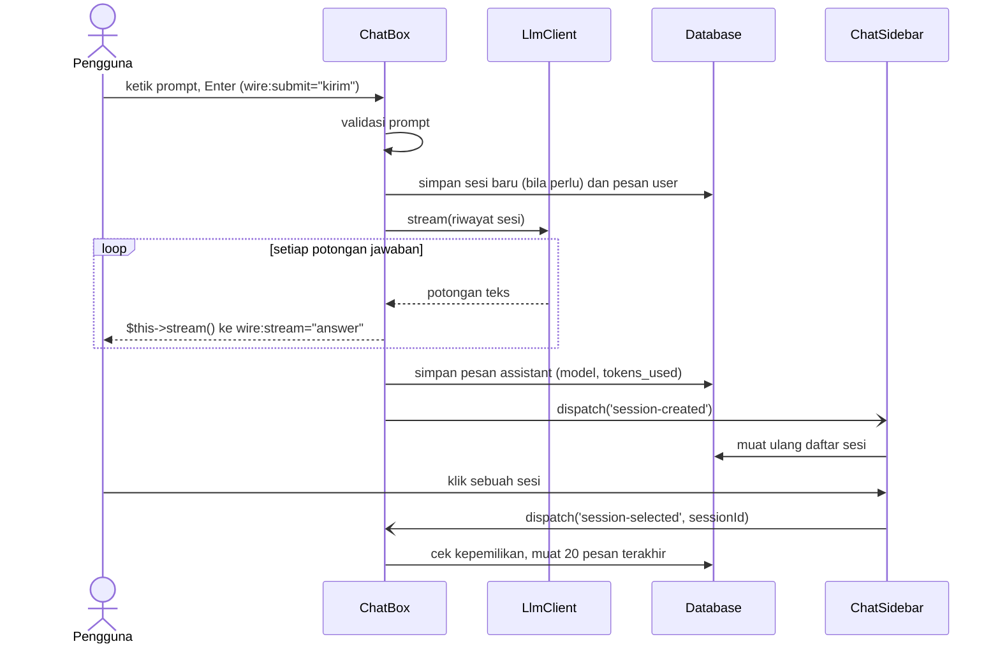
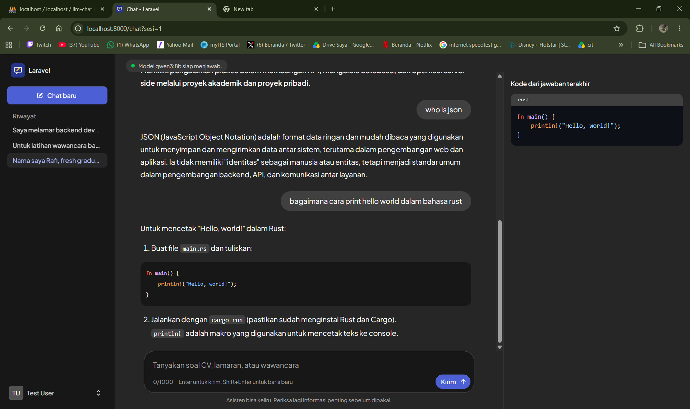
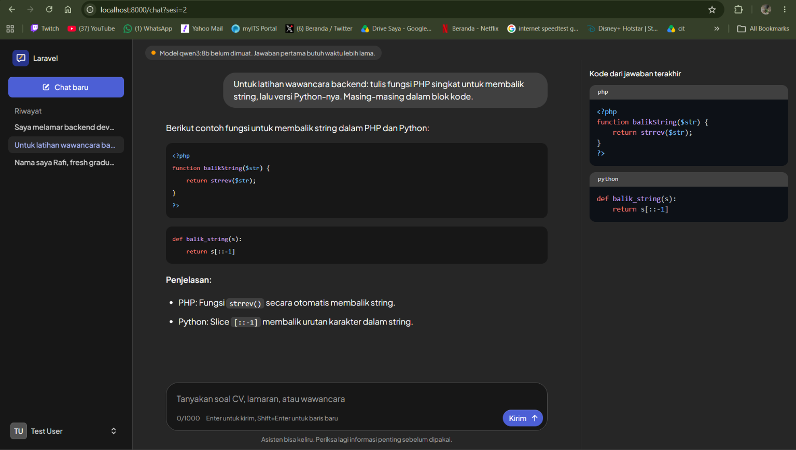
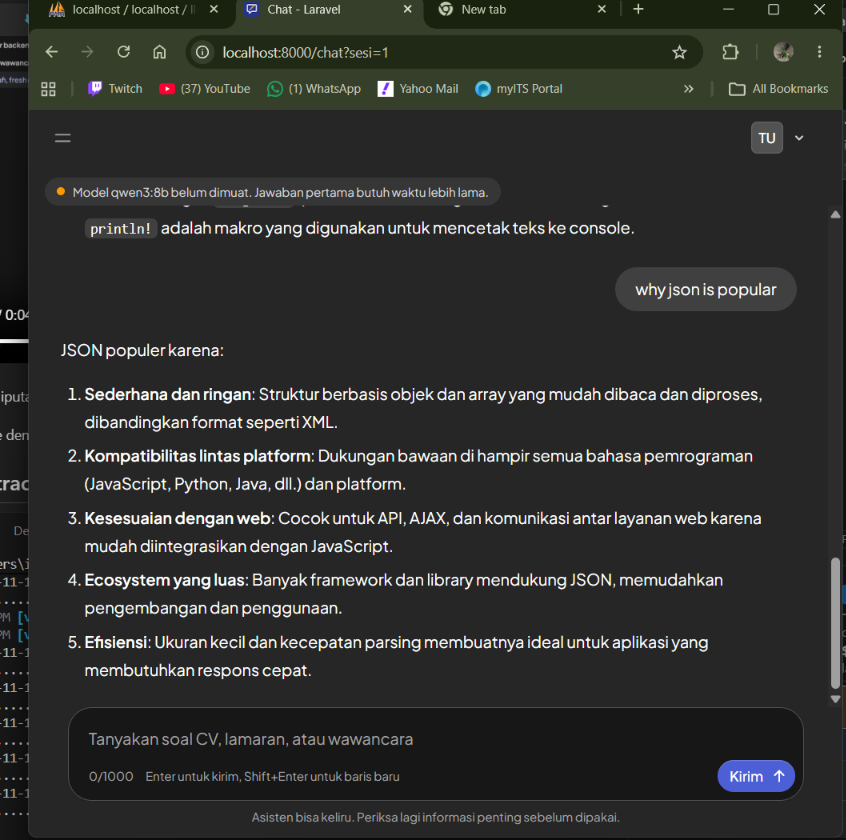

# Secure & Reactive AI Chat Hub

Aplikasi Laravel bertema **asisten AI untuk pencari kerja**. Ada dua cara memakainya:

- **Halaman chat** (`/chat`) berbasis Livewire: balon percakapan, jawaban yang mengalir kata demi kata, dan
  riwayat per sesi. Hanya bisa dibuka setelah login.
- **API** (`/api/...`) yang dilindungi token Sanctum, untuk Postman atau aplikasi lain.

Keduanya memakai kelas yang sama (`App\Services\LlmClient`) dan tabel yang sama (`chat_sessions`,
`chat_messages`). LLM utama adalah Ollama lokal. Jika Ollama gagal dihubungi, permintaan dialihkan ke
Senopati AI ITS.

## Instalasi lokal

Butuh PHP 8.5, Composer, Node.js, MySQL, dan [Ollama](https://ollama.com).

1. Buat database MySQL kosong bernama `llm-chat`.
2. Pasang dependensi dan siapkan aplikasi:

   ```bash
   composer install
   cp .env.example .env
   php artisan key:generate
   ```

3. Sesuaikan `DB_USERNAME` dan `DB_PASSWORD` di `.env`, lalu buat tabel beserta akun contoh:

   ```bash
   php artisan migrate --seed
   ```

   Akun demo: `test@example.com` dengan password `password`. Selama `APP_ENV=local`, halaman login
   menampilkan tombol **Log in with the demo account** yang langsung masuk dengan akun ini. Tombol itu tidak
   muncul di lingkungan lain, karena password akun demo tertulis di halaman.

4. Siapkan model LLM:

   ```bash
   ollama pull qwen3:14b
   ollama serve
   ```

   `qwen3:14b` butuh sekitar 10 GB VRAM. Di GPU 8 GB, pakai `qwen3:8b` dan set `OLLAMA_MODEL=qwen3:8b` di `.env`.

5. Jalankan aplikasi (server PHP dan Vite sekaligus):

   ```bash
   npm install
   composer run dev
   ```

   Tanpa Vite (misalnya hanya `php artisan serve`), jalankan `npm run build` dulu agar CSS dan JavaScript,
   termasuk pewarna sintaks, ikut termuat.

6. Buka `http://localhost:8000` dan login. Setelah login Anda langsung masuk ke halaman chat.

Permintaan pertama setelah Ollama menganggur bisa memakan waktu lebih dari satu menit karena model dimuat ulang.

### Konfigurasi `.env`

| Kunci | Kegunaan |
| --- | --- |
| `OLLAMA_URL` | Alamat Ollama, bawaan `http://localhost:11434`. |
| `OLLAMA_MODEL` | Model Ollama, bawaan `qwen3:14b`. |
| `SENOPATI_URL` | Endpoint fallback. Kosongkan untuk mematikan fallback. |
| `SENOPATI_TOKEN` | Token Bearer untuk Senopati. |
| `SENOPATI_API_KEY` | Disediakan, belum dipakai (lihat catatan Senopati di bawah). |
| `SENOPATI_MODEL` | Nama model yang dikirim ke Senopati. |
| `LLM_SYSTEM_PROMPT` | Peran asisten. Ganti nilainya untuk mengganti tema. Satu baris, tanpa tanda kutip ganda di dalamnya. |
| `LLM_TIMEOUT` | Batas waktu tunggu jawaban LLM dalam detik, bawaan `120`. |

## Halaman chat (Livewire)

Halaman `/chat` terdiri dari tiga komponen Livewire. Dua yang pertama saling berkabar lewat event:

| Komponen | Tugas | Event |
| --- | --- | --- |
| `ChatSidebar` | Riwayat sesi milik pengguna (terbaru di atas) dan tombol "Chat baru", di bilah samping aplikasi. | Mengirim `session-selected`, mendengarkan `session-created`. |
| `ChatBox` | Percakapan, kotak pesan, dan panel kode di sisi kanan. | Mendengarkan `session-selected`, mengirim `session-created`. |
| `LlmStatus` | Indikator kesiapan model di atas percakapan, diperbarui sendiri dengan `wire:poll`. | Tidak ada. |

Tata letaknya mengikuti aplikasi chat AI pada umumnya: riwayat di kiri, percakapan di kolom tengah, kotak pesan
di bawah. Di layar sempit riwayat tersembunyi di balik tombol menu. Percakapan baru dibuka dengan sapaan dan
empat contoh permintaan yang mengisi kotak pesan saat diklik.

Perilaku yang perlu diketahui:

- Jawaban asisten ditampilkan sebagai Markdown (daftar, tabel, teks tebal, blok kode berwarna). HTML di dalam
  jawaban tidak dijalankan, hanya ditampilkan sebagai teks. Selama jawaban masih mengalir, teksnya tampil
  mentah dan baru dirapikan setelah selesai.
- Prompt wajib 3 sampai 1000 karakter; pesan kesalahan muncul di bawah kotak input.
- Enter mengirim pesan, Shift+Enter membuat baris baru. Tombol dan kotak input terkunci selama jawaban diproses.
- Jawaban dialirkan langsung dari LLM ke layar, lalu disimpan utuh setelah selesai. Jika aliran terputus di
  tengah, bagian yang sudah diterima tetap disimpan dan pengguna diberi tahu.
- Sesi yang sedang dibuka tercatat di URL (`/chat?sesi=12`), jadi refresh tidak menghilangkan percakapan.
  Layar menampilkan 20 pesan terakhir.
- Setiap aksi memeriksa ulang bahwa sesi memang milik pengguna yang login. Sesi orang lain menghasilkan 404.

### Alur



`LlmStatus` berjalan terpisah dari alur di atas: setiap 15 detik `wire:poll` memanggil `LlmClient::status()`,
yang bertanya ke Ollama (`GET /api/ps`) apakah model sedang dimuat.

### Challenge A+ halaman chat

Ketiganya dikerjakan.

| Challenge | Yang dibuat | Cara mencoba |
| --- | --- | --- |
| 1. Teks mengalir | `ChatBox::kirim` memanggil `LlmClient::stream()` dan meneruskan tiap potongan dengan `$this->stream()` ke elemen `wire:stream="answer"`. Ini aliran asli dari Ollama, bukan animasi. | Kirim pesan apa saja; jawaban muncul kata demi kata. |
| 2. Panel kode + pewarna sintaks | Blok kode berpagar (` ``` `) dari jawaban terakhir ditampilkan di panel kanan dalam `<pre>`, diwarnai [highlight.js](https://highlightjs.org). Panel hanya muncul jika jawaban terakhir memuat kode, dan hanya di layar lebar (mulai 1280 px). | Minta contoh kode, misalnya "tulis fungsi PHP untuk membalik string dalam blok kode". |
| 3. `wire:poll` status | `LlmStatus` menampilkan satu dari tiga keadaan: hijau (model siap), kuning (Ollama hidup tetapi model belum dimuat, jadi jawaban pertama lambat), merah (Ollama tidak terjangkau). | Buka `/chat` setelah Ollama menganggur 5 menit: indikator kuning. Kirim pesan, lalu indikator berubah hijau tanpa refresh. Matikan Ollama untuk melihat merah. |

Catatan:

- Blok kode juga diwarnai di dalam percakapan; panel kanan mengumpulkan blok kode dari jawaban terakhir saja.
- Blok kode selalu berlatar gelap, baik di mode terang maupun gelap.
- highlight.js adalah satu-satunya dependensi JavaScript yang ditambahkan (`package.json`), dimuat lewat
  `resources/js/app.js`.
- Dengan `php artisan serve` biasa (satu proses), permintaan polling menunggu selama sebuah jawaban sedang
  dialirkan, sehingga indikator baru berubah setelah jawaban selesai.

### Tampilan dan merek

| Hal | Di mana diatur |
| --- | --- |
| Nama aplikasi | `APP_NAME` di `.env` (bawaan "Asisten Karier"). Restart server setelah mengubahnya. |
| Warna aksen | `--color-nila` (indigo batik) dan `--color-sogan` (cokelat keemasan batik) di `resources/css/app.css`. |
| Huruf | Plus Jakarta Sans, didaftarkan di `vite.config.js`. |
| Logo | `resources/views/components/app-logo-icon.blade.php` dan `public/favicon.svg`. |

Halaman bawaan starter kit sudah diganti: `/` menjadi halaman perkenalan, dan `/dashboard` hanya mengalihkan
ke `/chat`. `favicon.ico` dan `apple-touch-icon.png` masih gambar bawaan Laravel; browser modern memakai
`favicon.svg`. Halaman login, daftar, dan pengaturan masih berbahasa Inggris.

### Tangkapan layar

Simpan gambar dengan nama berikut di `doc/screenshots/` agar tampil di sini.

| Tampilan | Berkas |
| --- | --- |
| Percakapan di layar lebar | `doc/screenshots/chat-desktop.png` |
| Jawaban sedang mengalir (video) | `doc/screenshots/chat-streaming.mp4` |
| Panel kode dengan pewarna sintaks | `doc/screenshots/chat-code-panel.png` |
| Layar sempit | `doc/screenshots/chat-mobile.png` |



<video src="doc/screenshots/chat-streaming.mp4" controls muted width="100%"></video>

Video tidak diputar? [Unduh atau buka videonya](doc/screenshots/chat-streaming.mp4).




## API Contract

Base URL: `http://localhost:8000/api`

Kirim header berikut di setiap permintaan:

| Header | Nilai | Wajib |
| --- | --- | --- |
| `Accept` | `application/json` | Ya |
| `Content-Type` | `application/json` | Ya |
| `Authorization` | `Bearer <access_token>` | Ya, kecuali `POST /login` |

### 1. `POST /api/login`

Menukar email dan password dengan token. Publik, dibatasi 5 percobaan per menit.

| Parameter | Tipe | Aturan |
| --- | --- | --- |
| `email` | string | Wajib, format email. |
| `password` | string | Wajib. |

**200 OK**

```json
{
  "access_token": "1|Xk3...",
  "token_type": "Bearer"
}
```

**401 Unauthorized** — email atau password salah.

```json
{
  "status": "error",
  "message": "Email atau password salah."
}
```

**422 Unprocessable Content** — input tidak valid.

```json
{
  "message": "The email field is required. (and 1 more error)",
  "errors": {
    "email": ["The email field is required."],
    "password": ["The password field is required."]
  }
}
```

**429 Too Many Requests** — lebih dari 5 percobaan dalam satu menit.

Endpoint ini tidak memanggil LLM, sehingga tidak pernah mengembalikan 503.

### 2. `POST /api/chat-ai`

Mengirim prompt dan menerima jawaban utuh. Dibatasi 30 permintaan per menit per pengguna.

| Parameter | Tipe | Aturan |
| --- | --- | --- |
| `prompt` | string | Wajib, maksimal 1000 karakter. |
| `session_id` | integer | Opsional. Harus sesi milik pengguna yang login. Tanpa parameter ini, sesi baru dibuat. |

Untuk melanjutkan percakapan, kirim `session_id` dari respons sebelumnya. Seluruh riwayat sesi ikut dikirim ke LLM.

**201 Created**

```json
{
  "status": "success",
  "data": {
    "session_id": 12,
    "model_used": "qwen3:14b",
    "prompt": "Jelaskan middleware!",
    "ai_response": "Middleware adalah...",
    "timestamp": "2026-08-28 09:30:00"
  }
}
```

**401 Unauthorized** — token tidak ada atau tidak valid.

```json
{
  "message": "Unauthenticated."
}
```

**422 Unprocessable Content** — prompt kosong, lebih dari 1000 karakter, atau `session_id` bukan milik pengguna.

```json
{
  "message": "The prompt field is required.",
  "errors": {
    "prompt": ["The prompt field is required."]
  }
}
```

**503 Service Unavailable** — Ollama dan Senopati sama-sama gagal. Prompt pengguna tetap tersimpan.

```json
{
  "status": "error",
  "message": "Layanan AI sedang tidak tersedia. Silakan coba lagi nanti."
}
```

### 3. `POST /api/chat-ai/stream`

Sama seperti `/api/chat-ai`, tetapi jawaban dikirim sepotong demi sepotong sebagai Server-Sent Events
(`Content-Type: text/event-stream`). Parameter dan aturan validasinya sama.

**200 OK** — setiap potongan jawaban adalah satu event berisi JSON. Event terakhir menandai selesai dan membawa
`session_id` untuk melanjutkan percakapan. Jawaban utuh disimpan ke database setelah stream selesai.

```
data: {"content":"Middleware"}

data: {"content":" adalah..."}

data: {"done":true,"session_id":12,"model_used":"qwen3:14b"}
```

**401 Unauthorized** dan **422 Unprocessable Content** — sama seperti `/api/chat-ai`, dikirim sebagai JSON biasa
sebelum stream dimulai.

**LLM gagal (padanan 503)** — status HTTP sudah terkirim sebagai 200 saat stream dibuka, sehingga kegagalan
dilaporkan lewat event `error`. Prompt pengguna tetap tersimpan.

```
event: error
data: {"status":"error","message":"Layanan AI sedang tidak tersedia. Silakan coba lagi nanti."}
```

Jika Ollama gagal sebelum mengirim apa pun, jawaban Senopati dikirim sebagai satu event `data` utuh.

Contoh dengan curl:

```bash
curl -N -X POST http://localhost:8000/api/chat-ai/stream \
  -H "Accept: application/json" \
  -H "Content-Type: application/json" \
  -H "Authorization: Bearer <access_token>" \
  -d '{"prompt": "Bantu saya menyiapkan jawaban wawancara"}'
```

### Challenge A+ API

Ketiganya dikerjakan.

| Challenge | Yang dibuat | Cara mencoba |
| --- | --- | --- |
| 1. System prompt | `LlmClient` selalu menyisipkan `LLM_SYSTEM_PROMPT` sebagai pesan `system` pertama, untuk API maupun halaman chat. | Tanyakan hal di luar topik karier; asisten menolak dengan sopan. Ganti nilainya di `.env` untuk mengganti tema. |
| 2. Fallback Senopati | Jika Ollama tidak terjangkau, kehabisan waktu, atau mengembalikan status gagal, kegagalannya dicatat sebagai peringatan di log lalu permintaan dialihkan ke Senopati. Fallback dilewati bila `SENOPATI_URL` kosong. | Matikan Ollama lalu kirim prompt. Lihat catatan di bawah: format permintaan Senopati masih perlu dikonfirmasi. |
| 3. Streaming SSE | `POST /api/chat-ai/stream` meneruskan potongan jawaban Ollama sebagai Server-Sent Events dan menyimpan jawaban utuh setelah selesai. | Jalankan contoh curl di bagian endpoint tersebut. |

## Catatan fallback Senopati

Format API Senopati belum diverifikasi dengan dokumentasi resminya. Implementasi saat ini mengikuti contoh di
slide: mengirim `prompt` ke `SENOPATI_URL` dan membaca `result` dari jawabannya. Jika format aslinya berbeda,
cukup ubah method `askSenopati` di `app/Services/LlmClient.php`.

## Tes

```bash
php artisan test --compact tests/Feature/Api    # API
php artisan test --compact tests/Feature/Chat   # halaman chat
php artisan test --compact                      # semuanya
```

Tes memakai `Http::fake` dan database SQLite di memori, jadi tidak memerlukan Ollama maupun MySQL yang hidup.
